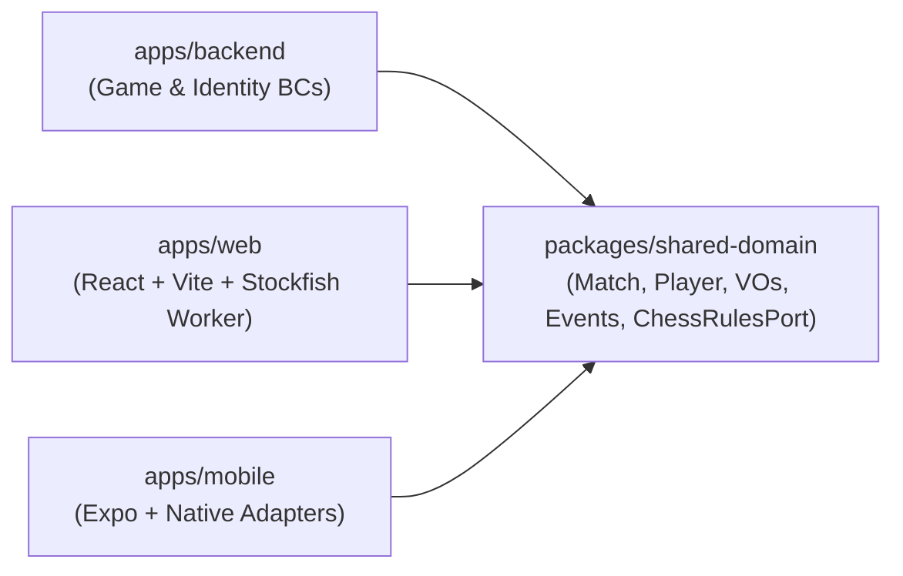

# Chess Platform

Monorepo con arquitectura hexagonal / DDD para una plataforma de ajedrez multiplataforma.

## Estructura del Monorepo

- `packages/shared-domain`: Núcleo compartido en TypeScript puro (entidades, value objects, eventos de dominio, puertos y adaptador `chess.js`).
- `apps/backend`: API y servidor en tiempo real con **NestJS**, **Socket.io**, **Prisma** y **PostgreSQL**.
- `apps/web`: Aplicación web con **React**, **Vite** y **Tailwind CSS**.
- `apps/mobile`: Aplicación móvil con **React Native (Expo)** y **TypeScript**.

## Requisitos

- Node.js >= 20
- pnpm >= 10

## Comandos principales

```bash
# Instalar dependencias en todo el monorepo
pnpm install

# Compilar el dominio compartido
pnpm build:shared

# Levantar cada aplicación
pnpm dev:backend
pnpm dev:web
pnpm dev:mobile
```

## Diagrama DDD (Bounded Contexts)


